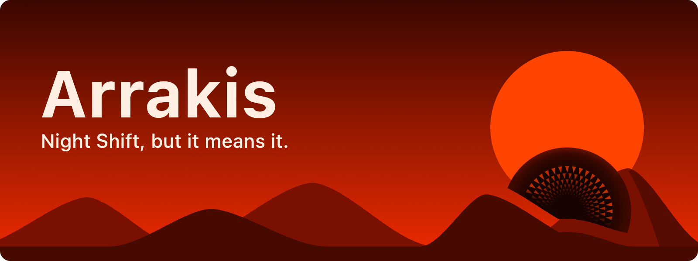
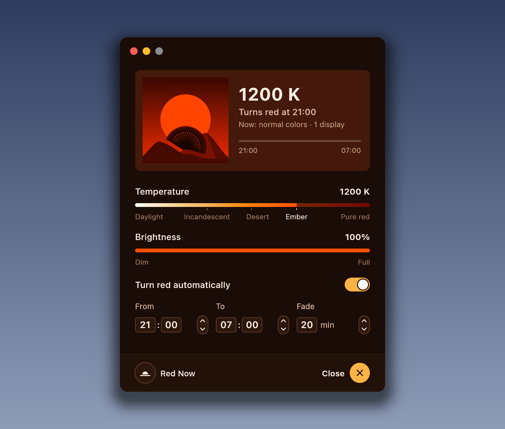
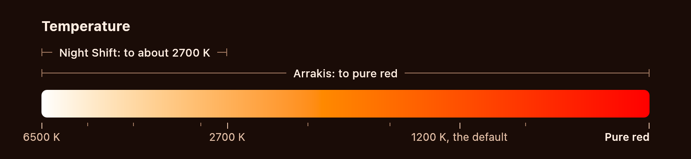

<p align="center">
  
</p>

<p align="center">
  A macOS menu-bar app that turns every display red on a schedule.<br>
  <a href="#install">Install</a> · <a href="#use">Use</a> · <a href="#under-the-hood">Under the hood</a> · <a href="#known-problems">Known problems</a>
</p>

<p align="center">
  
</p>
<p align="center"><sub>One evening, simulated: no screenshot can see the tint.</sub></p>

<p align="center">
  
</p>

Night Shift stops at a warm orange. Arrakis follows the black-body curve to
the end, where only red is left, and tints each display's color table, so
everything turns red: windows, video, even the cursor.

## Install

**With Homebrew**, on an Apple silicon Mac with macOS 15 or later:

```sh
brew install zininyahor/tap/arrakis
ditto "$(brew --prefix arrakis)/Arrakis.app" /Applications/Arrakis.app
```

Homebrew builds Arrakis from source on your Mac. For the build it brings Rust
and LLVM, about 2.2 GB, and keeps them while Arrakis is installed. Homebrew
links its own `cargo` and `rustc` into its `bin`: if you have Rust of your own,
check `which cargo`, and `brew unlink rust` takes Homebrew's out. To update,
quit Arrakis, run `brew upgrade arrakis`, remove the old copy with
`rm -rf /Applications/Arrakis.app`, then run the same `ditto` line: `ditto`
merges into an old copy, and a file that the new version dropped would stay in
the bundle and break its seal.

On macOS 14 or an Intel Mac, Homebrew has no ready Rust (its bottles are for
Apple silicon on macOS 15 and later), so build from source.

**From source.** You need macOS 14 or later, [Rust](https://rustup.rs) and the
Xcode Command Line Tools.

```sh
git clone https://github.com/ZininYahor/arrakis
cd arrakis
scripts/bundle.sh
ditto target/bundle/Arrakis.app /Applications/Arrakis.app
```

> [!NOTE]
> The default schedule runs from 21:00 to 07:00. Inside it, the screen turns
> red about a second after the app starts. Quit from the menu bar, or press
> <kbd>⌘</kbd> <kbd>Q</kbd> in its window, to get the normal colors back.

<details>
<summary><b>Build notes and updates</b></summary>

The Command Line Tools come with `xcode-select --install`. Arrakis is tested
on macOS 26 on Apple silicon.

`scripts/bundle.sh` builds the release binary and wraps it in
`target/bundle/Arrakis.app`, with the app's icon, signed ad hoc. To update a
build from source, quit Arrakis, pull, run `rm -rf /Applications/Arrakis.app`,
then run the same two commands again.
On a Mac older than macOS 14 the script stops with a message before it builds
or writes anything.

`cargo run --release` still works. It runs the bare binary, which has no icon
of its own: macOS shows a generic executable icon for it. Only the bundle
carries the app's icon. Arrakis keeps out of the Dock either way, so the
bundle's icon shows in Finder and Spotlight, not in the Dock. The bare binary
also runs without the memory flag that the bundle's `Info.plist` sets
(`MallocSpaceEfficient=1`, which lets malloc give memory back sooner): it holds
3 to 9 MiB more than the bundle does, by state.

Xcode itself is needed only to change the window's Metal shader:
`scripts/build-metallib.sh` compiles it ahead, with Xcode's Metal Toolchain,
into the file the app loads, so that the first window opens without compiling
it.

</details>

## Use

<p align="center">
  
</p>

- **Temperature**: how red the night gets, from Daylight to Pure red.
- **Brightness**: how dim, down to 20%.
- **From, To, Fade**: the daily window, and the minutes each end takes.
- **Red Now**: the night look right away, whatever the time.

Closing the window keeps the schedule running, with the sun in the menu bar.

<details>
<summary><b>More about the window and the menu</b></summary>

The window opens with the sun in the menu bar, half sunk behind a dune.

While you hold a slider, the real screen follows. The picture at the top of
the window always shows your night look. The window keeps its contrast in
brightness, not in color, so it stays readable through its own red tint.

The Temperature track is a strip of light, lit up to the value. Its stops,
from left to right, are Daylight, at 6500 K; Incandescent, at 2700 K; Desert,
at 1760 K, halfway between Incandescent and Ember; Ember, at 1200 K; and Pure
red. Each has its name under the track. A drag catches on the three stops
between the ends and on pure red's end, and a click or press near one catches
it too. A Force Touch trackpad ticks there.

The daily window may cross midnight. The menu-bar menu can go red now, pause
the schedule, open the window, or quit.

</details>

<details>
<summary><b>Keyboard</b></summary>

- <kbd>Tab</kbd> moves between controls.
- <kbd>←</kbd> <kbd>↓</kbd> move a slider one step left, and <kbd>→</kbd>
  <kbd>↑</kbd> one step right. <kbd>Page Down</kbd> and <kbd>Page Up</kbd>
  move it four steps, and <kbd>Home</kbd> and <kbd>End</kbd> go to its ends.
- On Temperature, an arrow or a Page key lands on a stop it would step past,
  and <kbd>⌥</kbd> with an arrow jumps from stop to stop.
- In a time or the fade, <kbd>↑</kbd> <kbd>↓</kbd>, digits or the stepper
  change the value. In From and To, <kbd>←</kbd> <kbd>→</kbd> switch between
  hours and minutes.
- <kbd>Space</kbd> presses the focused button or switch.
- <kbd>Esc</kbd> or <kbd>⌘</kbd> <kbd>W</kbd> hides the window.
- <kbd>⌘</kbd> <kbd>Q</kbd> quits.

</details>

<details>
<summary><b>Settings file and command line</b></summary>

Settings, and a log named `arrakis.log`, are kept in
`~/Library/Application Support/dev.Arrakis.Arrakis/`. On its first start,
Arrakis copies the settings of Sunset Parabellum, as it was called before.
You can edit `settings.json` by hand:

```json
{
  "schedule_on": true,
  "start": "21:00",
  "end": "07:00",
  "fade_minutes": 20,
  "kelvin": 1200,
  "brightness": 100
}
```

`kelvin` runs from 6500 down to 850, which is pure red. `brightness` runs
from 100 down to 20. Values outside these ranges are pulled back in.

`--hidden` starts in the menu bar without the window. `--verbose` logs at
debug level.

</details>

## Under the hood

<p align="center">
  
</p>

- **Its own Metal painter**: egui's meshes go straight to Metal, with no wgpu
  in the binary, and GL as the fallback.
- **Built ahead**: the color table, the menu-bar icon and the shader are
  embedded.
- **Small**: a 4.8 MB binary in Rust, with no async runtime, no network and
  no telemetry.

### Next to f.lux

[f.lux 42.2 and Arrakis 0.1.0 on one Mac, each alone, at 1200 K, the window
closed, 5 minutes at rest](scripts/measure/flux-compare.sh):

|                         | Arrakis       | f.lux                   |
|-------------------------|---------------|-------------------------|
| Memory                  | 11.7-11.9 MiB | 33.2-34.5 MiB           |
| CPU time                | 23-27 ms      | 324-337 ms              |
| CPU energy              | 0.51-0.59 mJ  | 7.5-8.4 mJ              |
| Interrupt wake-ups      | 118           | 315-320                 |
| Window open             | 20.3-20.4 MiB | 29.0-29.2 MiB           |
| Green, blue at 1200 K   | 31%, 0%       | 36%, 10%                |
| Green, blue at pure red | 0%, 0%        | Darkroom, not read      |
| Network                 | none linked   | update check, set daily |

f.lux follows the sun where you live, has more modes (Darkroom among them),
and runs on Macs back to macOS 10.9; Arrakis keeps a clock window and needs
macOS 14.

<details>
<summary><b>How these were read</b></summary>

On a MacBook Pro with an M1 Pro, macOS 26.6.2, on 16 November 2026. Each
app alone, started by `open`, its window closed after 30 s, read from 90 s
after the start for 5 minutes: three turns of f.lux and two of Arrakis,
mostly in turns. The counters are `proc_pid_rusage`'s (CPU time, CPU energy,
interrupt wake-ups, `phys_footprint`), and the display's table read back for
the color. macOS's Bluetooth daemon held about one core all along, through
every turn of both. "Network" is what each app links and what f.lux's
settings ask for; no traffic was read. The tools are in `scripts/measure/`
(`flux-compare.sh`, `rusagetool.c`, `tabledump.c`).

</details>

<details>
<summary><b>How the color works</b></summary>

- **Color.** Planck's law and the CIE 1931 color-matching functions give
  each temperature an sRGB color, scaled so that 6500 K changes nothing.
  Below about 850 K, green leaves the gamut and clips to zero.
- **Fades** move along that curve rather than between two colors, so they
  pass through orange and never through pink.
- **Your colors come back.** Before the first tint, the app saves each
  display's own color table, and it writes that table back when it quits.
  While the screen is red, it puts the tint back when macOS or another app
  resets it: macOS tells it of sleep, user switches and apps quitting, and
  it checks on its own, every 2 to 30 seconds, for the rest.

</details>

<details>
<summary><b>Checks, and how these pictures are made</b></summary>

```sh
cargo fmt --check
cargo clippy --all-targets --features demo -- -D warnings
cargo test --features demo
```

The color curve is not copied from anywhere. Tests check it against the
table in redshift's `colorramp.c` (Ingo Thies, 2013).

The pictures come from the app itself. The `demo` build draws a scene with
a clock it moves by hand, and leaves the real displays alone:

```sh
cargo run --features demo -- --demo-shot docs/banner.png --demo-scene banner
cargo run --features demo -- --demo-shot docs/evening.png --demo-scene evening
cargo run --features demo -- --demo-shot docs/temperature.png --demo-scene scale
cargo run --features demo -- --demo-shot docs/window.png --demo-scene day
cargo run --features demo -- --demo-shot docs/bench.png --demo-scene bench
```

The banner's worm is the window's: the same code draws both. The figures in
`docs/bench.png` are constants in `src/demo.rs`, each with the reading it
comes from: its build, its date and its recipe.

Screenshots of a window cannot see the system's traffic lights either, so
the demo paints them in and rounds the corners as macOS does.

The app's icon is drawn the same way, from the cover's sun and dunes and the
palette. `assets/icon.png` is its 1024 px master, and `scripts/bundle.sh`
makes the bundle's `.icns` from it:

```sh
cargo run --features demo -- --demo-icon assets/icon.png
```

</details>

## Made with AI

The code, the tests and this README were written by AI coding agents
(Claude Code). The author directed the work: what the app does, how it looks,
and which changes went in.

Every change passed the test suite (more than 1000 tests) and a review, also
by AI. No person has read every line. Arrakis changes your displays' color
tables: it comes as it is, with no warranty (see the [license](LICENSE)).

## Known problems

- Only one app can own a display's color table. f.lux, Lunar and other
  gamma tools will fight with Arrakis.
- Sidecar, AirPlay and DisplayLink displays may ignore color tables. Some
  M5 Macs on macOS 26 are reported to accept them without showing them.
- Night Shift is applied on top. Turn it off for an exact look.

<br>

<p align="center"><sub>Color fit by Wyman, Sloan and Shirley · built on egui and <a href="https://github.com/crmne/fastframe">fastframe</a> · <a href="LICENSE">MIT license</a></sub></p>
